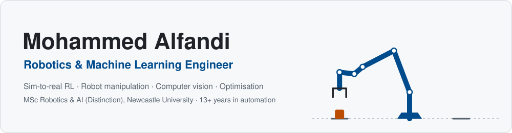

<picture>
  <source media="(prefers-color-scheme: dark)" srcset="assets/banner-dark.svg">
  <source media="(prefers-color-scheme: light)" srcset="assets/banner-light.svg">
  
</picture>

## About me

I work on **robot learning**: training manipulation policies in simulation and making them
work on real hardware. I recently completed an **MSc in Robotics & AI at Newcastle University
(Distinction)**, where my dissertation transferred reinforcement-learning policies from
simulation to a real UR3e arm and distilled them into vision-language-action models.

Before that I spent 13+ years as an engineer in Syria, China, Ghana and Türkiye: running a
20-machine CNC department, commissioning robotic production lines for solar components, and
building machine-learning forecasting pipelines for humanitarian operations across 1,328 sites.

- **Research interests:** sim-to-real RL, diffusion-based domain randomisation, vision-language-action models, embodied AI
- **Engineering:** robot kinematics and control, edge computer vision, PLCs and factory automation
- **Data & optimisation:** forecasting, robust multi-objective optimisation under uncertainty
- **Open to** robotics and machine-learning engineering roles in the UK

## Featured projects

<!-- REPOS:START -->
| Project | What it does | Built with |
|---|---|---|
| [**pv-thermal-defect-mapper**](https://github.com/Mohammedgmail/pv-thermal-defect-mapper) | Finds hot cells, failed bypass diodes and offline strings in drone thermal images of a solar farm and maps each one to the exact module and cell using the flight plan's camera poses, with pose refinement from the plant itself. Tested on a thermal digital twin and on real Raptor Maps crops. | Python `computer-vision` `defect-detection` `digital-twin` |
| [**pv-drone-inspection-planner**](https://github.com/Mohammedgmail/pv-drone-inspection-planner) | Drone mission planner for thermal inspection of solar farms: finds the valid irradiance window, keeps the sun's reflection out of the camera, splits batteries, exports ArduPilot/QGroundControl missions. Flown and verified in ArduPilot SITL. | Python `ardupilot` `drone` `inspection` |
| [**ros2-ur-ik-service**](https://github.com/Mohammedgmail/ros2-ur-ik-service) | ROS 2 inverse and forward kinematics services for Universal Robots UR3e, UR5e and UR10e: closed-form, all 8 solutions, closest to the current joint state. Humble and Jazzy, Docker-ready. | Python `docker` `inverse-kinematics` `python` |
| [**pv-power-forecasting**](https://github.com/Mohammedgmail/pv-power-forecasting) | Solar PV power forecasting from open weather data: pvlib physics + gradient boosting with conformal prediction intervals, 30 min to day-ahead, tested on a year of NREL measurements. | Python `conformal-prediction` `forecasting` `gradient-boosting` |
| [**robust-moo-water-energy**](https://github.com/Mohammedgmail/robust-moo-water-energy) | Scenario-based robust multi-objective planning of solar water-energy systems under climate, fuel-price and grid uncertainty (Pyomo + HiGHS): CVaR, worst-case, AUGMECON Pareto fronts, TOPSIS. | Python `climate-adaptation` `cvar` `humanitarian` |
| [**ur3e-reach-rl**](https://github.com/Mohammedgmail/ur3e-reach-rl) | UR3e reaching with reinforcement learning: MuJoCo + Gymnasium environment built from the real DH model, SAC and SAC+HER baselines with trained policies. | Python `gymnasium` `hindsight-experience-replay` `manipulation` |
| [**ur-kinematics**](https://github.com/Mohammedgmail/ur-kinematics) | Tested Python kinematics for Universal Robots e-Series arms (UR3e, UR5e, UR10e): forward/inverse kinematics, Jacobian, manipulability. | Python `forward-kinematics` `inverse-kinematics` `kinematics` |
| [**PGDA**](https://github.com/Mohammedgmail/PGDA) |  |  |
<!-- REPOS:END -->

This list refreshes itself every day through GitHub Actions.

## Research highlight: PGDA (MSc dissertation)

**Physically-Grounded Diffusion Augmentation for robust robot manipulation.** Standard domain
randomisation varies appearance and physics independently, so a policy cannot learn that an
object which *looks* like rubber also *behaves* like rubber. PGDA binds Stable Diffusion
material textures to matching mass, friction and inertia ranges, then trains a SAC+HER pushing
policy with a ResNet-18 visual encoder for a UR3e arm.

| Experiment | Result |
|---|---|
| Mismatched texture (ablation) | Success drops by **43.4 pp**: the policy genuinely relies on material cues |
| Real UR3e, material label supplied | **96.7 %** success vs 63–70 % for standard domain randomisation |
| Distilled into an Octo VLA model (simulation) | **59 %** vs 41 % for the baseline |

Paper in preparation for *IEEE Robotics and Automation Letters*.

## Publications

- **Alfandi, M.** & Seçkiner, S. U.(2026). A scenario-based robust multi-objective optimization framework for
  climate-resilient water-energy systems. *Journal of Cleaner Production*.
  [Article](https://www.sciencedirect.com/science/article/abs/pii/S0959652626020573)
- **Alfandi, M.** & Seçkiner, S. U. (2025). Renewable energy and greenhouse gas reduction for
  water supply in conflict-affected Syria. *Renewable and Sustainable Energy Reviews*, 211, 115353.
  [doi:10.1016/j.rser.2025.115353](https://doi.org/10.1016/j.rser.2025.115353)
- **Alfandi, M.** & Seçkiner, S. U. (2022). Robotic process automation: a literature review on
  quantitative benefits. *Proc. Int. Conf. on Industrial Engineering and Operations Management*,
  Istanbul, pp. 280–295.

## Tech stack

**Machine learning**&nbsp;

**Robotics**&nbsp;

**Tools**&nbsp;

**Design & manufacturing**&nbsp;

## Experience at a glance

| Years | Role | Where |
|---|---|---|
| 2025–2026 | MSc Robotics & Artificial Intelligence (Distinction) | Newcastle University, UK |
| 2021–2024 | Postgraduate Researcher, Industrial Engineering | Gaziantep University, Türkiye |
| 2020–2024 | Technical Programme Manager / Data Engineer | Relief International & IHR, Türkiye |
| 2018–2020 | Technical Manager, Automation & Renewable Energy | Falioun Intelligente Dynamik, Türkiye |
| 2015–2017 | Head of CNC Department | United Fabrication, Ghana |
| 2014–2015 | Founder & Factory Manager | Guangzhou, China |
| 2010–2014 | Engineering Team Lead | Directorate of Engineering and Services, Syria |

## Connect

The banner is a UR3e doing pick-and-place, with every frame solved by the analytical inverse
kinematics in [ur-kinematics](https://github.com/Mohammedgmail/ur-kinematics)
(see [`scripts/make_banner.py`](scripts/make_banner.py)).
